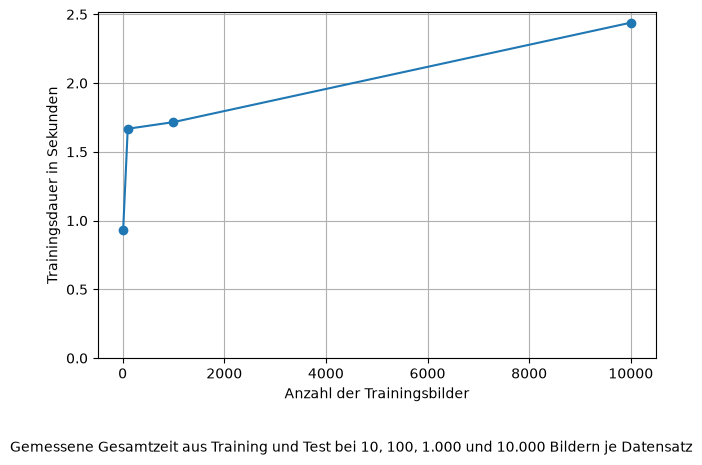
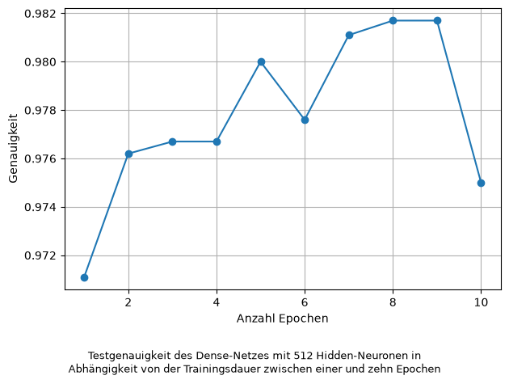
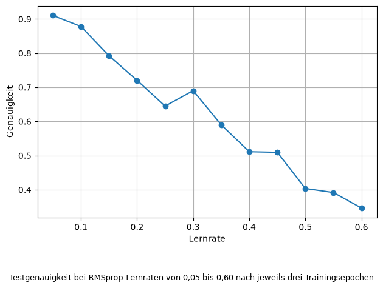
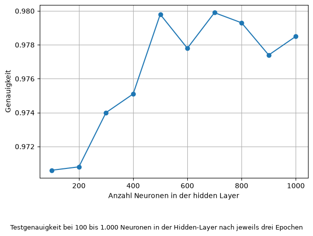
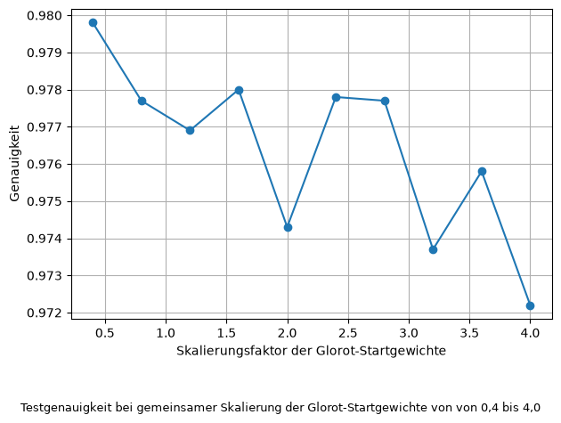
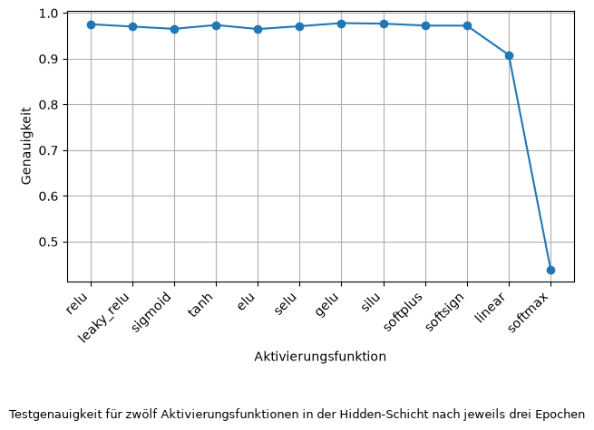
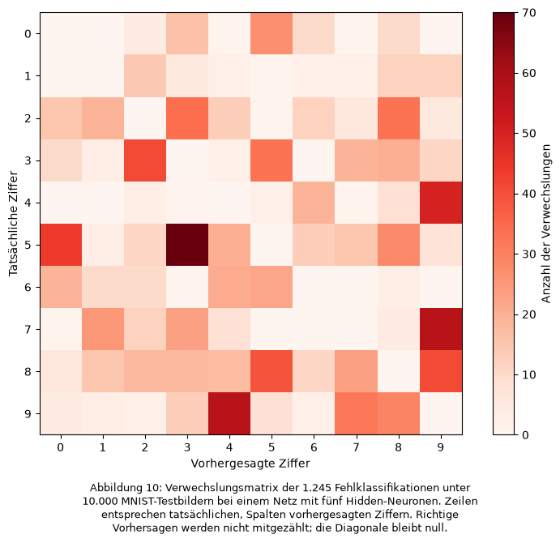

# Neuronale Netzwerke – Aufgabenbearbeitung

## Allgemeine Aufgabenstellung

Nutzen Sie für die folgenden Aufgaben den MNIST-Datensatz und den oben zur Verfügung vorgestellten Code zu BabyNN. Für die Erstellung der Graphen können Sie z.B. ``matplotlib.pyplot`` verwenden.
Achtung: Einige der folgenden Aufgaben können bei Verwendung großer Datenmengen viel Laufzeit und Energie erfordern. Achten Sie auf sparsame Verwendung der Ressourcen und nutzen passend gekürzte Datensätze.
Die Genauigkeit kann mit der BabyNN-Methode *accuracy* gemessen werden.

## 1. Zeitvergleich Trainieren und Testen


### Aufgabenstellung

Wählen Sie gleich große Trainings- und Testdatensätze (z.B. 10, 100, 1000 Bilder). Messen und vergleichen Sie die benötigten Zeiten. Stellen Sie die Ergebnisse mittels Python graphisch dar.


### Abbildung



### Ausgeführter Code

```python
import keras # This requires pytorch ==> pip install pytorch
from keras.datasets import mnist
from keras import models
from keras import layers
from keras.utils import to_categorical
import time
import numpy as np
import matplotlib.pyplot as plt

# Download the MNIST data
(train_images, train_labels), (test_images, test_labels) = mnist.load_data()

# define and format train and test data
train_images = train_images.reshape(-1, 28 * 28).astype("float32") / 255.0
test_images = test_images.reshape(-1, 28 * 28).astype("float32") / 255.0

train_images_amount = []
train_duration = []

for i in range(1, 5):
    # Neuronales Netz erstellen
    network = models.Sequential([
        layers.Input(shape=(28 * 28,)),
        layers.Dense(512, activation="relu"),
        layers.Dense(10, activation="softmax")
    ])

    # Modell konfigurieren
    network.compile(
        optimizer=keras.optimizers.RMSprop(),
        loss="sparse_categorical_crossentropy",
        metrics=["accuracy"]
    )
    
    train_images_selected = train_images[:10**i]
    train_labels_selected = train_labels[:10**i]
    test_images_selected = test_images[:10**i]
    test_labels_selected = test_labels[:10**i]

    start_training = time.perf_counter()

    network.fit(train_images_selected, train_labels_selected, epochs=3)

    duration_training = time.perf_counter() - start_training

    print(f"Trainingsdauer: {duration_training:.3f} Sekunden für {10**i} Bilder")

    start_testing = time.perf_counter()

    test_loss, test_acc = network.evaluate(test_images_selected, test_labels_selected)

    duration_testing = time.perf_counter() - start_testing

    print(f"Testdauer: {duration_testing:.3f} Sekunden")

    train_images_amount.append(10**i)
    train_duration.append(duration_training+duration_testing)

plt.plot(train_images_amount, train_duration, marker="o")
plt.ylim(bottom=0)
plt.xlabel("Anzahl der Trainingsbilder")
plt.ylabel("Trainingsdauer in Sekunden")
plt.grid(True)
plt.figtext(0.5, 0.04, 'Gemessene Gesamtzeit aus Training und Test bei 10, 100, 1.000 und 10.000 Bildern je Datensatz', va="bottom", ha="center")
plt.tight_layout(rect=(0, 0.12, 1, 1))
plt.show()
```


## 2. Zusammenhang zwischen Epochen und Genauigkeit


### Aufgabenstellung

Erstellen Sie eine Grafik, die den Zusammenhang zwischen der Anzahl der verwendeten Epochen (z.B. von 1 bis 10) beim Training und der Genauigkeit des Netzes darstellt. Interpretieren Sie die Ergebnisse.


### Abbildung




### Ausgeführter Code

```python
import keras # This requires pytorch ==> pip install pytorch
from keras.datasets import mnist
from keras import models
from keras import layers
from keras.utils import to_categorical
import numpy as np
import matplotlib.pyplot as plt

# Download the MNIST data
(train_images, train_labels), (test_images, test_labels) = mnist.load_data()

# define and format train and test data
train_images = train_images.reshape(-1, 28 * 28).astype("float32") / 255.0
test_images = test_images.reshape(-1, 28 * 28).astype("float32") / 255.0

amount_epochs = []
accuracy = []

for i in range(1, 11):
    # Neuronales Netz erstellen
    network = models.Sequential([
        layers.Input(shape=(28 * 28,)),
        layers.Dense(512, activation="relu"),
        layers.Dense(10, activation="softmax")
    ])

    # Modell konfigurieren
    network.compile(
        optimizer=keras.optimizers.RMSprop(),
        loss="sparse_categorical_crossentropy",
        metrics=["accuracy"]
    )

    # Training starten
    network.fit(train_images, train_labels, epochs=i)

    # Tests starten
    test_loss, test_acc = network.evaluate(test_images, test_labels)

    amount_epochs.append(i)
    accuracy.append(test_acc)

# Graph erstellen
plt.plot(amount_epochs, accuracy, marker="o")
plt.xlabel("Anzahl Epochen")
plt.ylabel("Genauigkeit")
plt.grid(True)
plt.figtext(0.5, 0.02, 'Testgenauigkeit des Dense-Netzes mit 512 Hidden-Neuronen in\nAbhängigkeit von der Trainingsdauer zwischen einer und zehn Epochen',
            ha="center", va="bottom", fontsize=9)
plt.tight_layout(rect=(0, 0.12, 1, 1))
plt.show()
```


## 3. Zusammenhang zwischen Lernrate und Genauigkeit


### Aufgabenstellung

Erstellen Sie eine Grafik, die den Zusammenhang zwischen der verwendeten Lernrate (z.B. von 0.05 bis 0.6 step 0.05) und der Genauigkeit des Netzes darstellt.  Interpretieren Sie die Ergebnisse.


### Abbildung




### Ausgeführter Code

```python
import keras # This requires pytorch ==> pip install pytorch
from keras.datasets import mnist
from keras import models
from keras import layers
from keras.utils import to_categorical
import numpy as np
import matplotlib.pyplot as plt

# Download the MNIST data
(train_images, train_labels), (test_images, test_labels) = mnist.load_data()

# define and format train and test data
train_images = train_images.reshape(-1, 28 * 28).astype("float32") / 255.0
test_images = test_images.reshape(-1, 28 * 28).astype("float32") / 255.0

learning_rates = []
accuracy = []

for i in range(1, 13):
    # Lernrate festlegen
    learning_rate = i * 0.05 # RMSprop Standard liegt bei 0.001
    
    # Neuronales Netz erstellen
    network = models.Sequential([
        layers.Input(shape=(28 * 28,)),
        layers.Dense(512, activation="relu"),
        layers.Dense(10, activation="softmax")
    ])

    # Modell konfigurieren
    network.compile(
        optimizer=keras.optimizers.RMSprop(learning_rate),
        loss="sparse_categorical_crossentropy",
        metrics=["accuracy"]
    )

    # Training starten
    network.fit(train_images, train_labels, epochs=3)

    # Tests starten
    test_loss, test_acc = network.evaluate(test_images, test_labels)

    learning_rates.append(learning_rate)
    accuracy.append(test_acc)

# Graph erstellen
plt.plot(learning_rates, accuracy, marker="o")
plt.xlabel("Lernrate")
plt.ylabel("Genauigkeit")
plt.grid(True)
plt.figtext(0.5, 0.02, 'Testgenauigkeit bei RMSprop-Lernraten von 0,05 bis 0,60 nach jeweils drei Trainingsepochen',
            ha="center", va="bottom", fontsize=9)
plt.tight_layout(rect=(0, 0.12, 1, 1))
plt.show()
```


## 4. Zusammenhang zwischen Anzahl der versteckten Neuronen und Genauigkeit


### Aufgabenstellung

Erstellen Sie eine Grafik, die den Zusammenhang zwischen der verwendeten Anzahl versteckter Neuronen (i.e. Neuronen des Hidden Layers) z.B. von 50 bis 400 in 20er Schritten und der Genauigkeit des Netzes darstellt.  Interpretieren Sie die Ergebnisse.


### Abbildung



### Ausgeführter Code

```python
import keras # This requires pytorch ==> pip install pytorch
from keras.datasets import mnist
from keras import models
from keras import layers
from keras.utils import to_categorical
import numpy as np
import matplotlib.pyplot as plt

# Download the MNIST data
(train_images, train_labels), (test_images, test_labels) = mnist.load_data()

# define and format train and test data
train_images = train_images.reshape(-1, 28 * 28).astype("float32") / 255.0
test_images = test_images.reshape(-1, 28 * 28).astype("float32") / 255.0

amount_neurons = []
accuracy = []

for i in range(1, 11):
    # Anzahl Neuronen in der hidden Layer festlegen
    neurons = i * 100
    
    # Neuronales Netz erstellen
    network = models.Sequential([
        layers.Input(shape=(28 * 28,)),
        layers.Dense(neurons, activation="relu"),
        layers.Dense(10, activation="softmax")
    ])

    # Modell konfigurieren
    network.compile(
        optimizer=keras.optimizers.RMSprop(),
        loss="sparse_categorical_crossentropy",
        metrics=["accuracy"]
    )

    # Training starten
    network.fit(train_images, train_labels, epochs=3)

    # Tests starten
    test_loss, test_acc = network.evaluate(test_images, test_labels)

    amount_neurons.append(neurons)
    accuracy.append(test_acc)

# Graph erstellen
plt.plot(amount_neurons, accuracy, marker="o")
plt.xlabel("Anzahl Neuronen in der hidden Layer")
plt.ylabel("Genauigkeit")
plt.grid(True)
plt.figtext(0.5, 0.02, 'Testgenauigkeit bei 100 bis 1.000 Neuronen in der Hidden-Layer nach jeweils drei Epochen',
            ha="center", va="bottom", fontsize=9)
plt.tight_layout(rect=(0, 0.12, 1, 1))
plt.show()
```


## 5. Zusammenhang zwischen Initialwert der Gewichte und Genauigkeit


### Aufgabenstellung

Erstellen Sie eine Grafik, die den Zusammenhang zwischen den Initialwerten der Gewichte und der Genauigkeit des Netzes darstellt. Passen Sie dazu geeignet die Initialwerte für  $W_{IH}, W_{HO}$ an.


### Abbildung




### Ausgeführter Code

```python
import keras # This requires pytorch ==> pip install pytorch
from keras.datasets import mnist
from keras import models
from keras import layers
from keras.utils import to_categorical
import numpy as np
import matplotlib.pyplot as plt

# Download the MNIST data
(train_images, train_labels), (test_images, test_labels) = mnist.load_data()

# define and format train and test data
train_images = train_images.reshape(-1, 28 * 28).astype("float32") / 255.0
test_images = test_images.reshape(-1, 28 * 28).astype("float32") / 255.0

gu_factors = []
accuracy = []

for i in range(1, 11):
    # Anzahl Neuronen in der hidden Layer festlegen
    factor = 0.4 * i
    
    # Neuronales Netz erstellen
    network = models.Sequential([
        layers.Input(shape=(28 * 28,)),
        layers.Dense(
            512,
            activation="relu",
            kernel_initializer=keras.initializers.VarianceScaling( # glorot_uniform aber angepasst
                scale=factor**2,
                mode="fan_avg",
                distribution="uniform",
                seed=123
            )
        ),
        layers.Dense(
            10, 
            activation="softmax",
            kernel_initializer=keras.initializers.VarianceScaling(
                scale=factor**2,
                mode="fan_avg",
                distribution="uniform",
                seed=123
            )
        )
    ])

    # Modell konfigurieren
    network.compile(
        optimizer=keras.optimizers.RMSprop(),
        loss="sparse_categorical_crossentropy",
        metrics=["accuracy"]
    )

    # Training starten
    network.fit(train_images, train_labels, epochs=3)

    # Tests starten
    test_loss, test_acc = network.evaluate(test_images, test_labels)

    gu_factors.append(factor)
    accuracy.append(test_acc)

# Graph erstellen
plt.plot(gu_factors, accuracy, marker="o")
plt.xlabel("Skalierungsfaktor der Glorot-Startgewichte")
plt.ylabel("Genauigkeit")
plt.grid(True)
plt.figtext(0.5, 0.02, 'Testgenauigkeit bei gemeinsamer Skalierung der Glorot-Startgewichte von von 0,4 bis 4,0',
            ha="center", va="bottom", fontsize=9)
plt.tight_layout(rect=(0, 0.12, 1, 1))
plt.show()
```


## 6. Zusammenhang zwischen Aktivierungsfunktion und Genauigkeit


### Aufgabenstellung

Erstellen Sie eine Grafik, die den Zusammenhang zwischen der verwendeten Aktivierungsfunktion und der Genauigkeit des Netzes darstellt. Sie müssen hierzu auf die Keras-Implementierung wechseln, da die $\sigma$-Funktion fest in die Backpropagation von BabyNN eingebaut ist.

- Wählen Sie dazu geeignete Keras-Aktivierungsfunktionen aus.
- Erstellen Sie einen Plot der verwendeten Funktionen. 
- Interpretieren Sie die Ergebnisse.


### Abbildung



### Ausgeführter Code

```python
import keras # This requires pytorch ==> pip install pytorch
from keras.datasets import mnist
from keras import models
from keras import layers
from keras.utils import to_categorical
import numpy as np
import matplotlib.pyplot as plt

# Download the MNIST data
(train_images, train_labels), (test_images, test_labels) = mnist.load_data()

# define and format train and test data
train_images = train_images.reshape(-1, 28 * 28).astype("float32") / 255.0
test_images = test_images.reshape(-1, 28 * 28).astype("float32") / 255.0

activation_functions = [
    "relu", 
    "leaky_relu",
    "sigmoid",
    "tanh",
    "elu",
    "selu",
    "gelu",
    "silu",
    "softplus",
    "softsign",
    "linear",
    "softmax"
]
accuracy = []

for i in range(1, 13):    
    # Neuronales Netz erstellen
    network = models.Sequential([
        layers.Input(shape=(28 * 28,)),
        layers.Dense(neurons, activation=activation_functions[i-1]),
        layers.Dense(10, activation="softmax")
    ])

    # Modell konfigurieren
    network.compile(
        optimizer=keras.optimizers.RMSprop(),
        loss="sparse_categorical_crossentropy",
        metrics=["accuracy"]
    )

    # Training starten
    network.fit(train_images, train_labels, epochs=3)

    # Tests starten
    test_loss, test_acc = network.evaluate(test_images, test_labels)

    accuracy.append(test_acc)

# Graph erstellen
plt.plot(activation_functions, accuracy, marker="o")
plt.xlabel("Aktivierungsfunktion")
plt.xticks(rotation=45, ha="right")
plt.ylabel("Genauigkeit")
plt.grid(True)
plt.tight_layout()
plt.figtext(0.5, 0.02, 'Testgenauigkeit für zwölf Aktivierungsfunktionen in der Hidden-Schicht nach jeweils drei Epochen',
            ha="center", va="bottom", fontsize=9)
plt.tight_layout(rect=(0, 0.12, 1, 1))
plt.show()
```


## 7. Outliers - besonders schlecht erkannte Zahlen


### Aufgabenstellung

Erstellen Sie eine Sammlung von 1.000 Bildern von Zahlen, die vom Netz falsch klassifiziert werden. Wir nennen Sie **Outliers**. Die Abbildung unten zeigt ein Beispiel, bei dem unklar ist, ob es sich um eine 2, 3 oder 6 handelt.

- Welche Zahlen werden besonders oft falsch klassifiziert?
- Welche Zahlen sind sich besonders ähnlich?
- Versuchen Sie, Erklärungen für die falsche Klassifikation zu finden.

### Abbildung



### Ausgeführter Code

```python
import keras # This requires pytorch ==> pip install pytorch
from keras.datasets import mnist
from keras import models
from keras import layers
from keras.utils import to_categorical
import numpy as np
import matplotlib.pyplot as plt

# Download the MNIST data
(train_images, train_labels), (test_images, test_labels) = mnist.load_data()

# define and format train and test data
train_images = train_images.reshape(-1, 28 * 28).astype("float32") / 255.0
test_images = test_images.reshape(-1, 28 * 28).astype("float32") / 255.0

# Neuronales Netz erstellen
network = models.Sequential([
    layers.Input(shape=(28 * 28,)),
    layers.Dense(5, activation="relu"),
    layers.Dense(10, activation="softmax")
])

# Modell konfigurieren
network.compile(
    optimizer=keras.optimizers.RMSprop(),
    loss="sparse_categorical_crossentropy",
    metrics=["accuracy"]
)

# Training starten
network.fit(train_images, train_labels, epochs=3)

# Tests starten
test_loss, test_acc = network.evaluate(test_images, test_labels)

probabilities = network.predict(test_images)
predictions = np.argmax(probabilities, axis=1)

i = 0
misclassified_images_amount = 0
confusions = np.zeros((10, 10), dtype=int)
for prediction in predictions:
    if predictions[i] != test_labels[i]:
        misclassified_images_amount += 1
        confusions[test_labels[i], predictions[i]] += 1
    i += 1

print(f"Anzahl falsch Klassifizierter Bilder: {misclassified_images_amount}")

plt.figure(figsize=(8, 6))
plt.imshow(confusions, cmap="Reds", interpolation="nearest")
plt.colorbar(label="Anzahl der Verwechslungen")

plt.xticks(range(10))
plt.yticks(range(10))
plt.xlabel("Vorhergesagte Ziffer")
plt.ylabel("Tatsächliche Ziffer")

plt.tight_layout()
plt.figtext(0.5, 0.02, 'Konfusionsmatrix der >1.000 Fehlklassifikationen',
            ha="center", va="bottom", fontsize=9)
plt.tight_layout(rect=(0, 0.12, 1, 1))
plt.show()
```


## 8. Verbesserung der Genauigkeit

### Aufgabenstellung

Mit dem hier vorgestellten NN kann eine Genauigkeit von >95% erzielt werden. Überlegen Sie sich neben den in den obigen Aufgaben adressierten Möglichkeiten weitere Möglichkeiten, um die Genauigkeit zu verbessern, und erproben Sie diese. Behalten Sie aber den Energieverbrauch im Auge. Tipp: Erzeugung zusätzlicher Trainingsbilder durch Drehung der bestehenden Trainingsbilder.

### Ergebnisse 

| Kennzahl | Wert |
|---|---:|
| Trainingsbilder einschließlich Varianten | 600.000 |
| Trainingsgenauigkeit nach Epoche 9 | 99,97 % |
| Trainings-Loss nach Epoche 9 | 0,000931 |
| Testgenauigkeit | 98,58 % |
| Test-Loss | 0,0756 |

### Ausgeführter Code

```python
import keras
from keras.datasets import mnist
from keras import models, layers
import numpy as np

keras.utils.set_random_seed(123)

# MNIST laden
(train_images, train_labels), (test_images, test_labels) = mnist.load_data()

# Für die Rotation zunächst als Bilder mit einem Farbkanal formatieren.
train_images = train_images.astype("float32")[..., None] / 255.0
test_images = test_images.reshape(-1, 28 * 28).astype("float32") / 255.0

# Vor der Bearbeitung anders speichern
original_images = train_images
original_labels = train_labels

# Zufällige Drehungen erzeugen
rotation = layers.RandomRotation(
    factor=0.04,
    fill_mode="constant",
    fill_value=0.0,
    seed=123
)

n = len(original_images)
augmentation_batch_size = 256

# Originale plus neun Varianten: insgesamt 600.000 Trainingsbilder.
augmented_images = np.empty((10 * n, 28, 28, 1), dtype=np.float32)
augmented_images[:n] = original_images
augmented_labels = np.tile(original_labels, 10)

for variant in range(9):
    offset = (variant + 1) * n

    for start in range(0, n, augmentation_batch_size):
        end = min(start + augmentation_batch_size, n)

        augmented_images[offset + start:offset + end] = rotation(
            original_images[start:end],
            training=True
        ).numpy()

    print(f"Gedrehte Variante {variant + 1}/9 erstellt.")

# Für das Dense-Netz wieder zu Vektoren mit 784 Werten umformen.
augmented_images = augmented_images.reshape(-1, 28 * 28)

# Neuronales Netz erstellen
network = models.Sequential([
    layers.Input(shape=(28 * 28,)),
    layers.Dense(512, activation="relu"),
    layers.Dense(512, activation="relu"),
    layers.Dense(512, activation="relu"),
    layers.Dense(10, activation="softmax")
])

# Modell konfigurieren
network.compile(
    optimizer=keras.optimizers.RMSprop(),
    loss="sparse_categorical_crossentropy",
    metrics=["accuracy"]
)

# Auf Originalen und vorbereiteten Varianten trainieren.
history = network.fit(
    augmented_images,
    augmented_labels,
    epochs=9,
    batch_size=1024,
    shuffle=True
)

# Abschließend auf unveränderten Testbildern bewerten.
test_loss, test_acc = network.evaluate(test_images, test_labels)

print(f"Testgenauigkeit: {test_acc:.2%}")
print(f"Test-Loss: {test_loss:.4f}")
```

## 9. Anwendung der Kettenregel


### Aufgabenstellung

Bestimmen Sie für die folgende Funktion die Ableitung mit Hilfe der Kettenregel:
$$f(x)=(1+\sin(x+2\cdot\cos(\frac{x}{2})))^2$$


### Ergebnis

$$
\boxed{
f'(x)=2\left(1+\sin\left(x+2\cos\left(\frac{x}{2}\right)\right)\right)
\cos\left(x+2\cos\left(\frac{x}{2}\right)\right)
\left(1-\sin\left(\frac{x}{2}\right)\right)
}.
$$
